# Album Cover Director

$album-cover-director は、アルバム、EP、シングルのジャケットを構想から3000px納品までディレクションするCodex Skill / Pluginです。曲名・歌詞・アルバムの文脈から複数の意味を拾い、最初に大胆で構造の異なる小さな候補をラベル付きで一覧にします。選んだ案の仕掛けを保ったまま、画像と一体化した正確な題字、細部、納品ファイルまで仕上げます。

トラックメイカー、音楽家、プロデューサー、インディーレーベル、デザイナーが共通で使えることを目的にしています。特定アーティストの設定、外部MCP、APIキーは必須ではありません。

## 最初に広く見て、選んだ案を仕上げる

既定の最初の一覧は **12種類のアイデア**。`deep` なら16種類です。それぞれに小さな画像、選択用ID、短い案名、歌詞や作品名から拾った意味を添えます。「もっと」と言われる前から、強い仕掛けを初回に含めます。

歌詞の名詞を小道具として並べるだけでなく、「誰が何を望み、何に阻まれ、どう変わるか」を複数の読みへ広げます。その読みを、図地反転、視点による錯視、不可能な帰路、二色の衝突、大きな余白、一つだけ不可能な日常の出来事などへ変換します。[24種類の探索レシピ](skills/album-cover-director/references/impact-recipes.md)は、実際に試すための発想の選択肢です。全方式の生成成功を検証済みという意味ではありません。

通常は4案入りのプレビュー3枚で12案を見せ、その中から1案を選び、単独のジャケットとして作り直します。プレビューの切り出しは完成品ではありません。「C07を本制作」「C02とC09」「C02の構図にC09の空気感」のようにも選べます。選択元の画像、意味、構図、残すべき仕掛けを記録し、仕上げでも引き継ぎます。12案の探索の中で、物質・空間・人物・平面・錯視を自由に使い、曲に合う仕掛けを選びます。物理的・空間的な案では、文字そのものと対象が接点・遮蔽・奥行きで関わるように作ります。広く探索する初回一覧には、利用者が除外しない限り実際に成立する錯視案も含めます。プロンプトに錯視と書くだけでは達成としません。平面も立体も選択肢として維持し、どちらも独立した絵に見出しを添えるだけの案にはしません。

一覧に出す前には、実際の画像を並べて構図の違いを確認します。ラベルや素材だけが違う似た案は作り直します。コードは確認記録と画像の一致を検査し、構図の違いそのものを自動認定するわけではありません。ラフは文字・細部が未校了のコンセプト案として扱い、本制作後に題字と納品品質を確認します。比較用ラベルはジャケット画像の外側に表示します。

## 作れるジャケット

### 文字が物理世界になる例

|  |  |
| --- | --- |
| 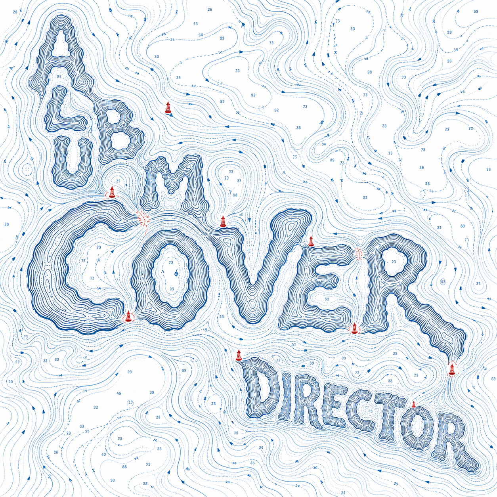 | 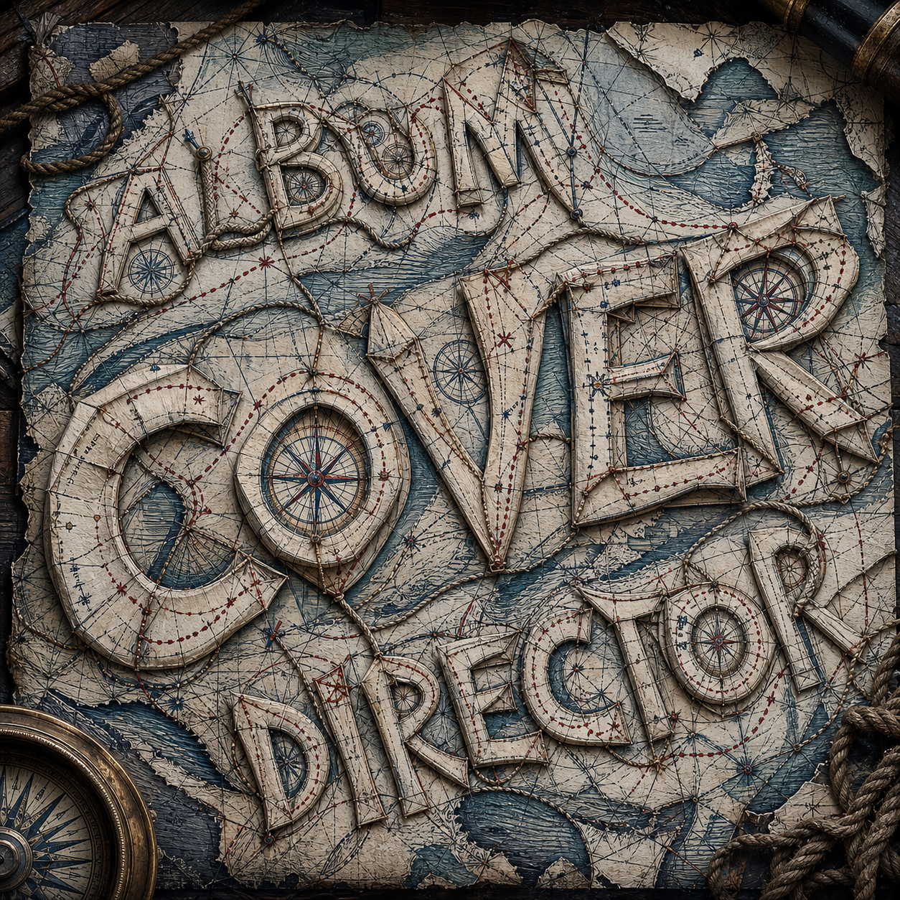 |
| **海洋図システム** — 等深線、航路、測線が文字の骨格を決める。 | **宝の地図** — 折り目、羅針盤、索具、赤い航路が題字を工作物にする。 |
|  | 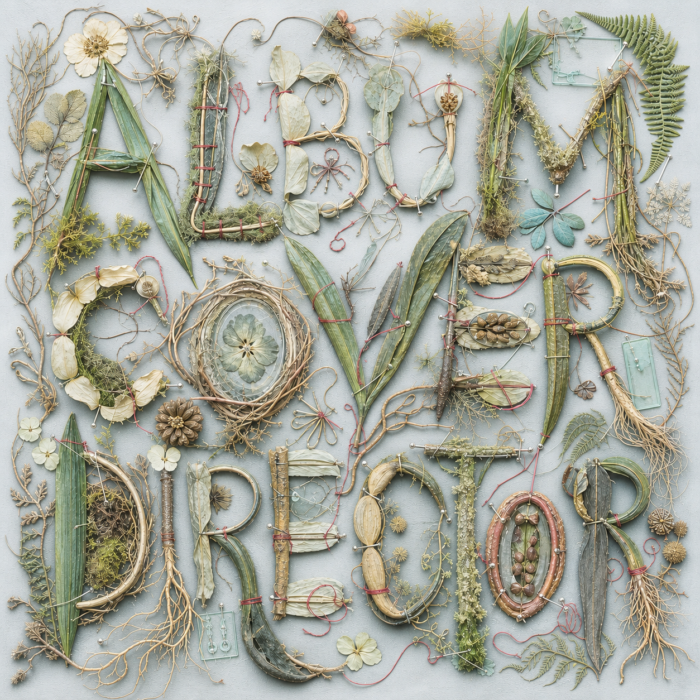 |
| **ボードゲーム** — タイル、コース、橋、コマが文字を遊べる構造にする。 | **植物標本** — 根、押し花、花弁、ピン、糸が文字を成長させる。 |
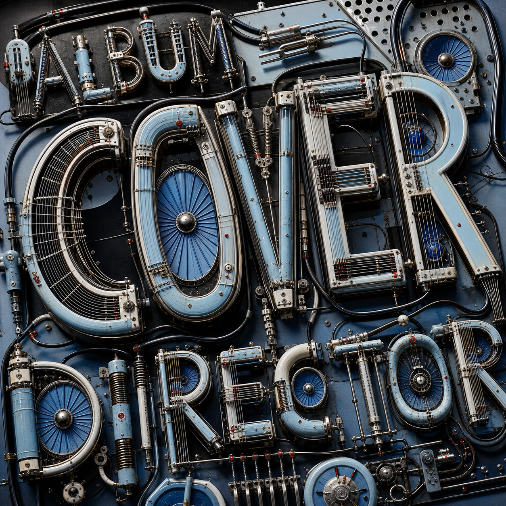

**機械音響システム** — 配管、ばね、共鳴器、配線が高密度な題字の工作物を組み上げる。

### 文字が空間現象になる型

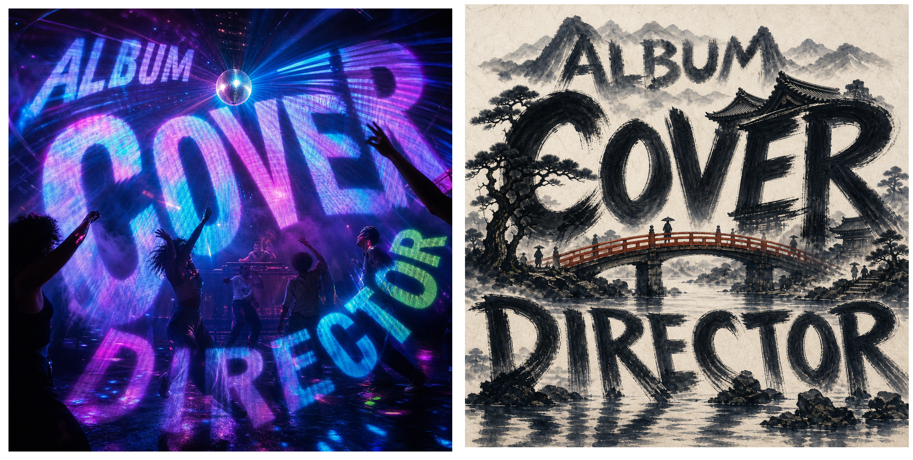

**回転する光のフィールド** — 小さなミラーボール、投影文字、スモーク、ダンサーがクラブ全体を一つの題字空間にする。文字の骨格は読ませたまま、光・空気・動きが画面の中へ題字を拡散する。

**水墨景観のフィールド** — 太い筆の英字骨格が、山、屋根、橋、川、霧、水面へ広がる。

### キャラクターと題字を一体化する4型

|  |  |
| --- | --- |
| 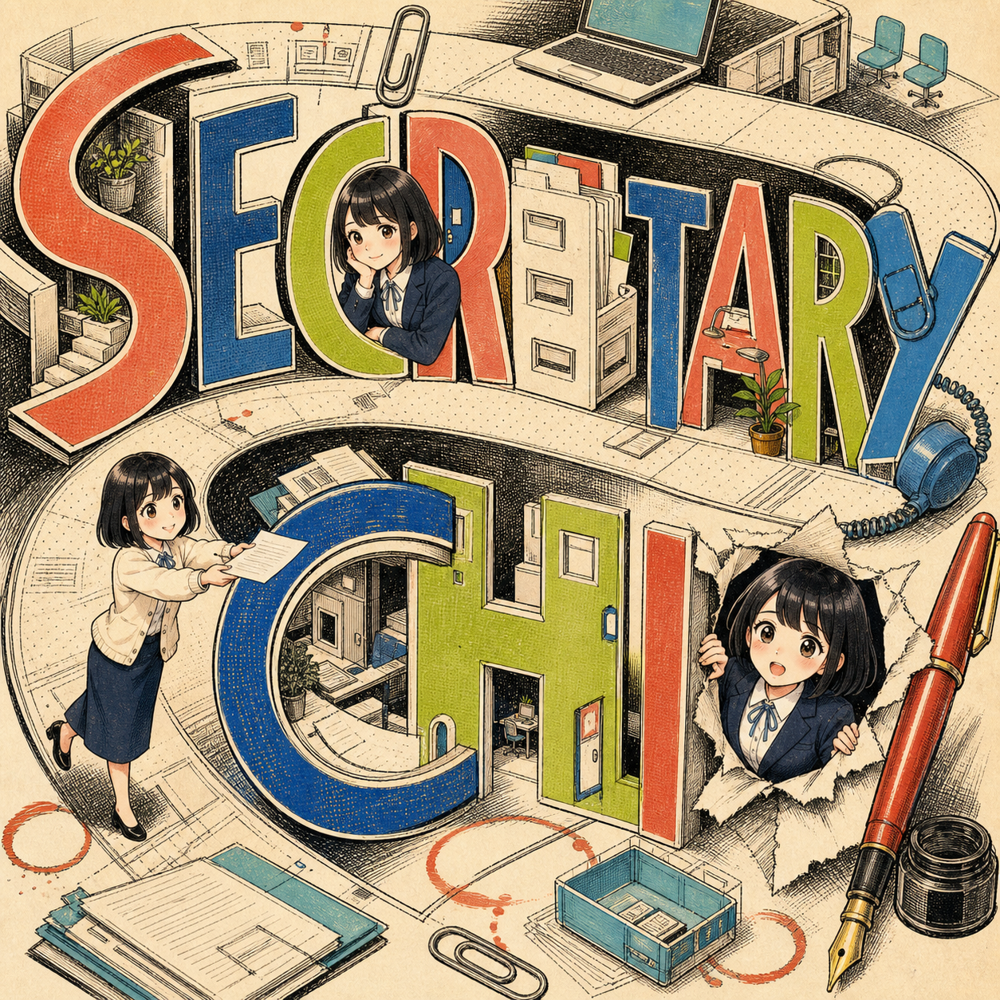 | 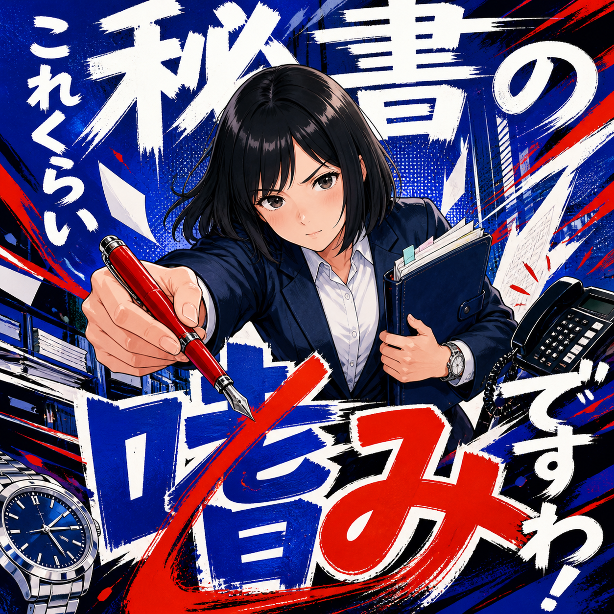 |
| **タイトル＝地図** — 文字そのものが世界になる。 | **キネティック・ワードマーク** — ジェスチャーと題字が一つの動きになる。 |
| 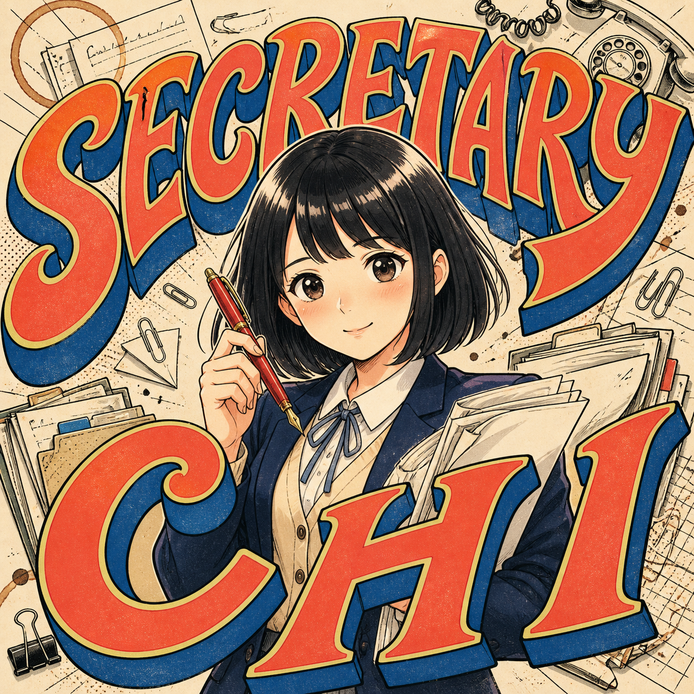 | 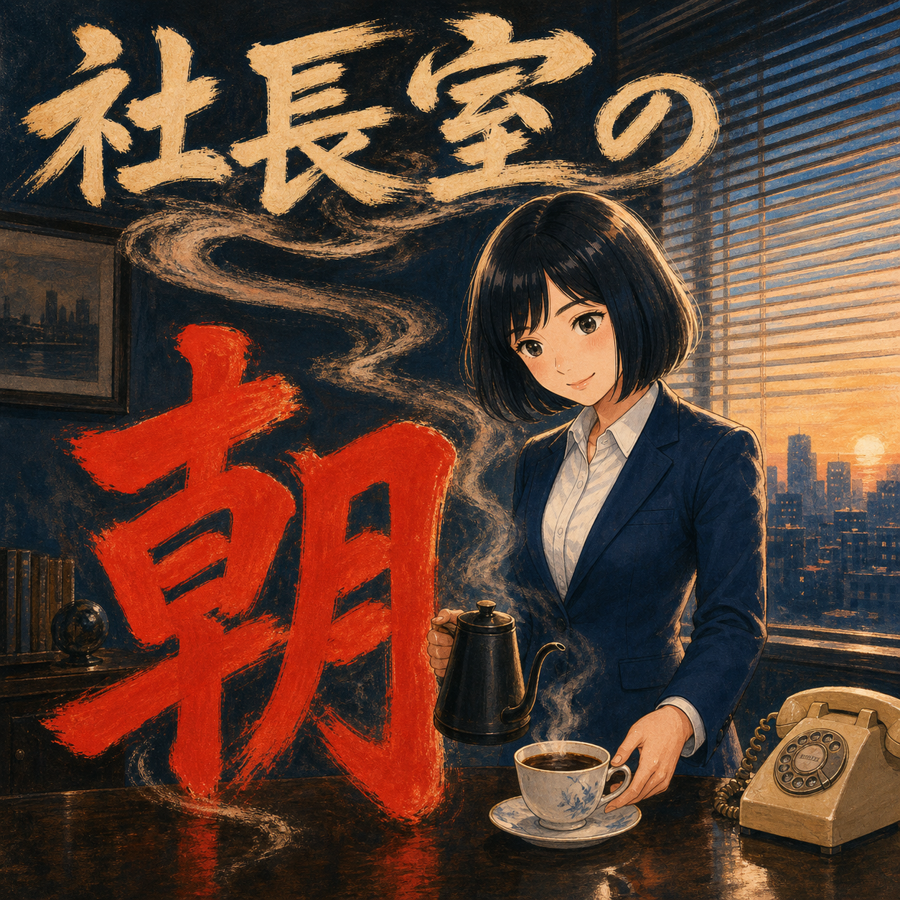 |
| **ヒーロー・ワードマーク** — 人物とタイトルが同じ階層を支配する。 | **日本語の階層** — 導入の文字列から、巨大な一文字へ展開する。 |

ここにある題字はすべて画像の中で同時に生成されています。題字の素材・構造・画像は一つのデザイン判断であり、後からフォント、描き直し、後組版、合成で直すことはありません。

この11例は、同格の3系統を示します。**物質タイトル世界**は、航路、工作物、ゲーム、標本などが文字の骨格を作る系統。**空間フィールド**は、光、反射、スモーク、動き、天候、建築が題字を正方形全体へ拡散・変形する系統。**キャラクター主導**は、入力されたartist systemや楽曲briefが人物を必要とするとき、人物の姿勢・行為・世界と題字を一つの構造にする系統です。空間フィールドでは、読み順のために通常の文字骨格を使ってよいですが、画像内で生成され、空間現象によって変形されなければなりません。完成したシーンの上に平らな文字を置くことは、どの系統でも認めません。

### 実際のリリースだと、こうなります

**仮タイトル「Ledger Faces」** — 同じ曲、同じ人物、同じ題字。振っているのは画面の組み立て方だけです。色違いではありません。

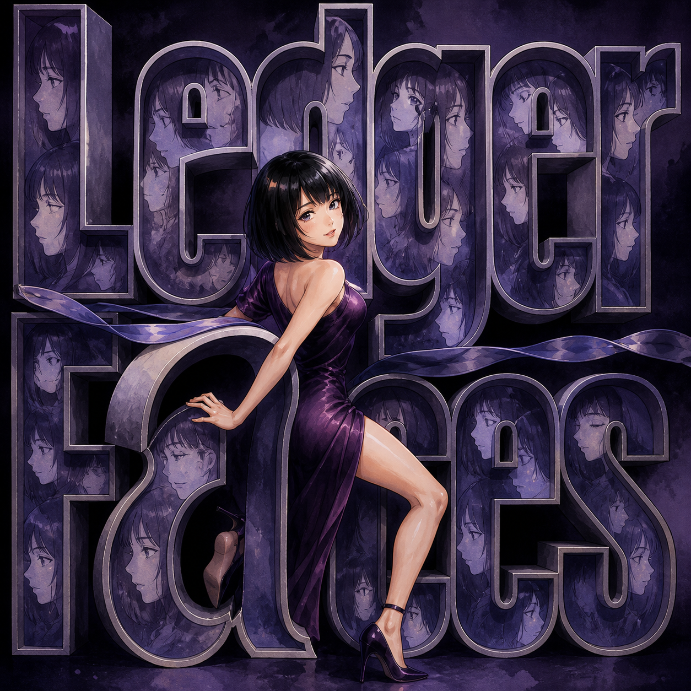

**キャラクター主導** — 巨大な文字の抜き穴が、複製された横顔で埋まる。生身の一人が `a` の穴から踏み出す。

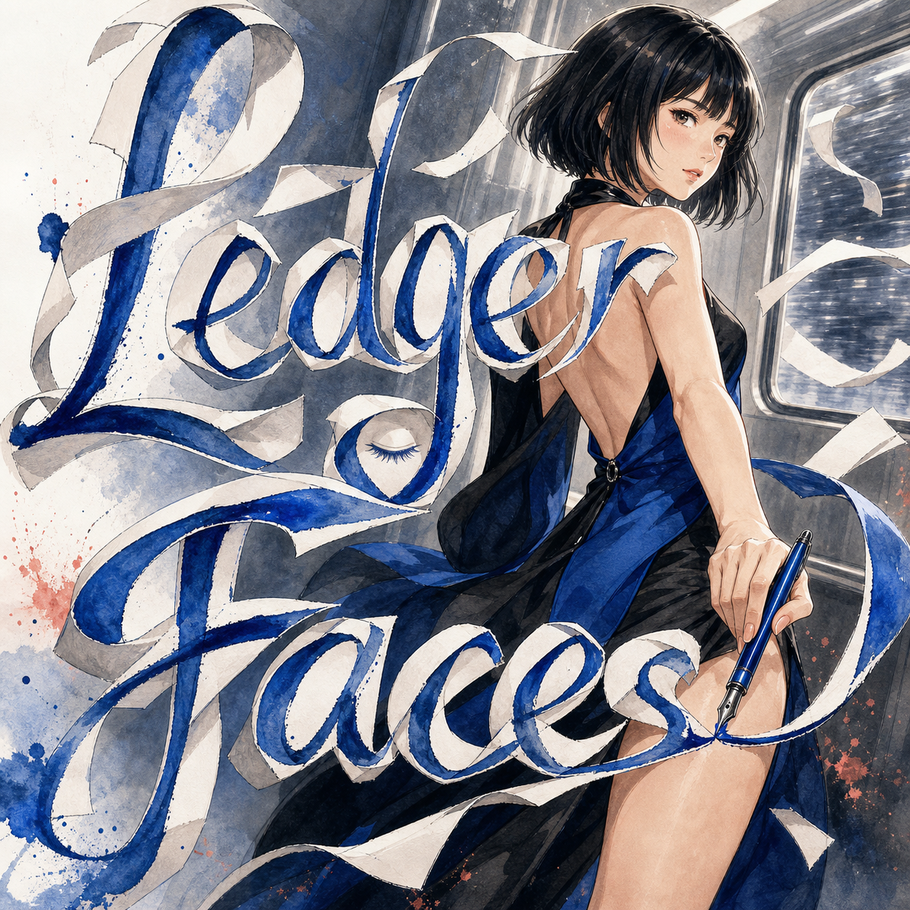

**物質タイトル世界** — 契約書の青い筆記線が、肩の後ろから手を通って脚の前へ抜ける。最後の一画を万年筆が書く。


**空間フィールド** — 改札のスキャナ光が、壁と体と床へ題字を投影する。手が遮った一本が、ガラスの反射に現れ直す。

この既存作例は、3系統を1曲へ当てた結果です。新しい実行では、必要に応じて平面のgraphic-fieldも含めた広い一覧から選び、本制作へ進みます。このギャラリーは新レシピやGPT Image 2.6の比較実験ではありません。

## 特徴

- 物質タイトル世界、空間フィールド、キャラクター主導、平面のgraphic-fieldという4つの画像内題字システム
- スタイル名ではなく「何が正方形を組織するか」を表す12の補助パターン
- quick / standard / deepで4 / 12 / 16種類の発想を最初に比較し、選択後に本制作
- 文字を後から足さず、画像の中でタイトルを成立させる独立ゲート
- ライブや空間を描く場合は、題字の面積・骨格・読み順・明暗優先度を先に固定し、その周辺だけに光、スモーク、動き、反射、トリミングの揺らぎを使う
- 56px、128px、256px、原寸、グレースケール、ぼかしの比較
- 1回1変数、最大2サイクルの修正
- 3000 x 3000 PNG/JPGと256pxサムネイルの再現可能な書き出し
- アーティスト設定とフィードバックをアーティスト単位に閉じた継続学習
- ローカルの発見を私的な制作物を出さずにコミュニティ向けカードへ変換する、一般利用者のための貢献導線

## インストール

Codexに次のように依頼できます。

~~~text
次のGitHubリポジトリから album-cover-director スキルをインストールして:
https://github.com/usedhonda/album-cover-director/tree/main/skills/album-cover-director
~~~

手動の場合:

~~~bash
git clone https://github.com/usedhonda/album-cover-director.git
mkdir -p ~/.agents/skills
ln -s "$PWD/album-cover-director/skills/album-cover-director" ~/.agents/skills/album-cover-director
~~~

インストール後にCodexを再起動してください。リポジトリ直下は .codex-plugin/plugin.json を備えたPlugin bundleでもあり、CodexのPlugin marketplaceへ内容を組み替えず掲載できます。

## 使い方

~~~text
$album-cover-director
作品名: Glass Weather
実行量: standard
歌詞: ...
アーティスト情報: /path/to/artist-information.md
参考画像: /path/to/character.png
画像の使い方: 同じキャラクターとして使い、構図や場面は曲ごとに変える
~~~

自然文でも起動します。

~~~text
この新曲のジャケットを、歌詞とアルバム名も踏まえて12案見たい。
最初から大胆な仕掛けも入れて、小さい画像とラベルを一覧にして。
選んだ案を3000pxまで仕上げて。
~~~

必須入力は一つだけです。

- 正確な作品名

歌詞とアーティスト情報は任意です。歌詞はプロンプト本文への貼り付けとファイルパス指定の両方に対応します。アーティスト情報には、名前、ジャンル、曲調、強調したい要素、継続キャラクター、画風、色彩、題字方針、避けたい表現、参考情報などを自由に含められます。何も追加されなければ、作品名から考えられる仮説として制作を進めます。曲名とアルバム名が両方あっても、文脈として使う名前を勝手に画像へ追加しません。

参考画像も任意です。画像を添付するかファイルパスを指定し、同じ人物・キャラクターとして使う、画像そのものを加工して使う、雰囲気だけを参考にする、のいずれかを指定できます。明確な場合はSkillが意図を判定します。同じキャラクターを継続しても、ポーズ、行動、場面、構図、光、色、題字構造は曲ごとに作り直します。実画像そのものを使う場合は、利用権限のある画像だけを対象にします。

継続するアーティストでは、そのアーティストのルートに `.album-cover-director/` を初期化します。そこにある `artist-system.md` はそのアーティストだけに使用します。明示したアーティスト情報パスはその一回だけに使い、Skillはアーティスト設定をグローバルに記憶したり、別アーティストへ持ち越したりしません。

| 実行量 | 最初に並べる異なる案 | 選択後の本制作候補 |
| --- | ---: | ---: |
| quick | 4案 | 選んだ案ごとに1枚 |
| standard（既定） | 12案 | 選んだ案ごとに1枚 |
| deep | 16案 | 選んだ案ごとに1枚 |

枚数や予算の明示指定を優先します。既に案が決まっている場合や直接本制作を頼んだ場合は一覧を省略できます。従来の3方向・3 / 6 / 12枚の直接制作とv1契約も維持しています。

実行意図は、一覧で選ぶところまでの `explore`、探索から選択・修正・納品へ進む既定の `production`、ローカルの比較実験を記録する `improve-skill` です。選択を任された場合はSkillが比較して続け、それ以外は一覧から選んで本制作へ進みます。

文字モードは auto、image-native、custom-wordmark。題字システムは auto、material-world、spatial-field、character-led、graphic-field です。ラフも正確なタイトルを画像内で生成するよう指示し、残る文字の問題は明示します。完成品のタイトルをあとからフォント、描き直し、合成で足すことはしません。詳細は [concept-exploration.md](skills/album-cover-director/references/concept-exploration.md) を参照してください。

## アーティスト単位のローカル学習

個別リリースのフォルダではなく、アーティストのルートで一度だけ初期化します。

~~~bash
python scripts/project-workspace.py init --artist-root .
~~~

```text
<artist-root>/
├── .album-cover-director/               # 非公開・Git無視
│   ├── artist-system.md                 # アーティスト全体で保つ連続性
│   └── feedback/
│       ├── learned-preferences.md       # 繰り返しの好みを自動集約
│       └── <release-slug>/
│           ├── feedback.json            # 採用・修正・評価の記録
│           └── images/                  # 全候補・参照入力を自動保存
└── album-cover/
    └── <release-slug>/                  # brief、prompt、master、納品物
```

生成候補、採用案、不採用案、持ち込んだ参照画像など、評価に使った画像はすべて `feedback/<release-slug>/images/` に自動コピーします。利用者が参照画像と試作画像を仕分ける必要はありません。`.album-cover-director/` の内容をSkillはコミットもアップロードも行いません。

artist systemは必須の記入フォームではありません。最初になければ、曲・アーティスト説明・参照画像からSkillが下書きを作り、利用者は自然文で直せます。既にある場合も、明示ルールは保護し、繰り返しのフィードバックか「アーティスト全体の方針にする」という明示指示があるときだけ更新します。詳細は [artist-system-onboarding.md](skills/album-cover-director/references/artist-system-onboarding.md) を参照してください。

候補を採用・不採用にしたら、Skillが `feedback/<release-slug>/feedback.json` と画像履歴を自動保存し、`feedback/learned-preferences.md` を更新します。同じ好みが3つのリリースで繰り返された場合だけ、要約へ昇格します。一度の好みは公開ルールにしません。公開Skillへ一般化するには、独立試行、条件の違い、未使用briefでの確認が必要です。詳細は [project-local-learning.md](skills/album-cover-director/references/project-local-learning.md) を参照してください。

## ローカルの発見を共有する

リポジトリ開発者でなくても貢献できます。「この学びをコミュニティへ共有したい」と言えば、Skillが私的な成功・失敗の対比を、抽象的な `title-behavior-card` の下書きへ変換します。下書きに入るのは構成原理、適用境界、却下テスト、証拠の要約だけです。曲名、artist system、歌詞、プロンプト、フィードバック原文、画像、ローカルパス、非公開試行IDは入りません。

下書きはレビューされるまで、そのリリースの非公開 `feedback/` フォルダ内に留まります。下書きの作成はアップロード、GitHub Issue、ブランチ、PRを一切作りません。公開には、その後の明示指示が必要です。詳細は [community-contributions.md](skills/album-cover-director/references/community-contributions.md) と [CONTRIBUTING.md](CONTRIBUTING.md) を参照してください。

長いタイトル、日本語、混植、記号の多いタイトルは、生成前に文字の複雑さを分類します。失敗時は画像内の階層、改行、保護する文字を組み直し、後組版では直しません。詳細は [title-complexity.md](skills/album-cover-director/references/title-complexity.md) を参照してください。

## タイトルを画像にする

タイトルを主役にする場合は、フォント名から始めません。次のいずれか一つの構図を選び、そこから曲固有の世界を発生させます。

- タイトル＝地図／世界の骨格
- タイトル＝中心モチーフを包む輪郭
- タイトル＝巨大なワードマークと記録痕のフィールド
- タイトル＝描画を侵食する記録痕
- タイトル＝中央メダリオンを公転する軌道
- タイトル＝光、反射、スモーク、動き、建築へ広がる空間フィールド
- タイトル＝図と地が反転する平面、形の衝突、反復の中の一つの断絶

各構図は、タイトルの占有率、読み順、中心モチーフとの関係、歌詞モチーフの配置、GPT Imageへの指示、失敗条件まで定義します。参照画像があっても、固有の文字・配色・モチーフ・配置を写さず、文字と画像の関係だけを曲固有の選択へ翻訳します。詳細は [title-image-architectures.md](skills/album-cover-director/references/title-image-architectures.md) を参照してください。

## 文字設計

custom-wordmark ではフォント名だけを指定しません。骨格、幅、太さ、カウンター、端部、リズム、加工原理を定義し、それを画像生成の指示に組み込みます。正確な綴り、字間、行間、ベースラインを満たさないAI生成文字は採用せず、タイトル画像の構造、各文字の位置、読み順、色、占有率を具体化して再生成します。

完成条件は、128pxで読めることに加え、画像を隠してもタイトル造形として成立することです。

## 成果物

~~~text
album-cover/<release-slug>/
├── creative-brief.yaml
├── run-contract.json                  # コンセプト探索
├── concept-board.html
├── production-contract.json           # 選択後の本制作
├── directions.md
├── prompts/
├── run-ledger.jsonl
├── selected-master.png
├── delivery/cover-3000.png
├── delivery/cover-3000.jpg
├── delivery/thumbnail-256.png
├── handoff-manifest.json
└── cover-report.md
~~~

`run-contract.json` には作品情報、根拠を持つ複数の解釈、実行環境、利用権限、案、画像の系譜、実画像の比較記録を残します。`concept-board.html` は小画像を埋め込んだ単一ファイルです。`production-contract.json` へ選択元画像と保持条件を引き継ぎ、完成候補を別に生成します。`handoff-manifest.json` は、選択した元画像、納品ファイル、構造化した人間による文字確認を記録できた後だけ作成します。画像生成環境またはPillowがない場合、完成したbrief、方向案、prompt、正確な書き出し仕様までは返しますが、「納品完了」とは表示しません。

## 一覧と選択のユーティリティ

プレビュー画像を生成して `run-contract.json` に記録した後、リポジトリのルートから実行します。

~~~bash
python skills/album-cover-director/scripts/prompt-preflight.py --contract run-contract.json
python skills/album-cover-director/scripts/concept-board.py --contract run-contract.json --output draft-board.html --draft
# 実画像を見比べ、diversity_reviewを記録してから選択用一覧を作る。
python skills/album-cover-director/scripts/concept-board.py --contract run-contract.json --output concept-board.html
python skills/album-cover-director/scripts/concept-selection.py --contract run-contract.json --candidate C07 --reason "図地反転で歌の矛盾が見える" --output production-contract.json
~~~

複数案を選ぶ場合は `--candidate` を繰り返します。主案に別案の雰囲気を取り入れる場合は、例えば `--candidate C02 --donor C09 --donor-trait "lighting:soft side light"` と指定します。借りる要素は色・光・質感に限定し、主案の構図は保ちます。契約内の画像パスは契約ファイルの場所を基準に解決します。HTMLは基本4列、画面幅に合わせて2列・1列になり、日本語ラベルに対応します。元画像へのラベル描画や変更は行いません。`--draft` は内部確認用で、通常の選択用一覧には全画像と一致する確認記録が必要です。これらのユーティリティ自体は画像APIの呼び出しや画像の混合作業を行いません。

GPT Image 2.6の実行指針も更新しています。Flare / Sunburstの指定や設定は利用環境が公開している場合だけ使い、実際のモデル・設定を記録します。選んだ構図と仕掛けの保持を優先します。APIキーや新しいサーバーは不要です。今回の実装対象は静止ジャケットで、SVG / GIFは含みません。詳細は [runtime-adapters.md](skills/album-cover-director/references/runtime-adapters.md) を参照してください。

## 研究と著作権

### GPT Image / ImageGenの最近の根拠

[2026-11-16調査レポート](research/gpt-image-2-6-evidence-2026-11-16.md)に、公式の2.6仕様と、11月4–16日のReddit・OpenAI Forum・実制作の一次報告を整理しました。[出典台帳](research/gpt-image-2-6-evidence-2026-11-16.json)には公開・観察・確認日、モデルと利用経路、設定、件数、取得範囲、商業性、限界を記録しています。[PR #8レビュー](research/reviews/pr-8-2026-11-16.md)では、指示の整合性と未検証の画像品質を区別しました。制作では必要に応じて[短い確認指針](skills/album-cover-director/references/image-quality-observations.md)を使い、既存の確認工程と予算内で判断します。

### ジャケットの先行事例

[research/corpus.yaml](research/corpus.yaml) は置換予定の旧ドラフトであり、制作時の正本ではありません。現在の限定教材セットは、根拠完備候補から抽出した [verified-principles.md](skills/album-cover-director/references/verified-principles.md) にあります。これは今の制作判断を良くするためのもので、制作中に前例収集を続ける理由にはしません。第三者のジャケット画像は収録しません。

新コーパスの採用条件は、ジャケット固有の評価根拠、文字支配度T4/T5、実物視覚確認、作品固有の転用原理です。名盤順位、売上、音楽的知名度はジャケット評価の根拠にしません。将来の拡張は、実際のカバー制作で同じ不足が繰り返し確認された場合だけに行い、音楽ジャンルの網羅を目的にしません。

[genre-diverse-title-intake.md](research/genre-diverse-title-intake.md) は、追加収集を6件で止めた独立の発見用ノートです。ここにあるリンクと観察は、私的なカバー試作で既存構図と異なる有効性を示すまで、制作ルールにはなりません。

[typography-led-genre-intake.yaml](research/typography-led-genre-intake.yaml) には、画像検索と目視確認で選んだ主要ジャンル横断の文字主導ジャケット候補を収録しています。第三者画像は保存せず、作品情報、参照ページ、文字が正方形を組織する方法、転用時の検証質問だけを記録します。候補は実制作の対比較と未使用briefで再現するまで、発見用のままです。

## 検証

~~~bash
python scripts/validate_repo.py
python -m unittest discover -s tests -v
~~~

CIではSkill frontmatter、Plugin manifest、旧ドラフト／最終コーパスの明示状態、研究チェックポイントと分布、リンク形式、第三者画像の不在、秘密情報・ローカル絶対パスの不在を検査します。

## ライセンス

コード、指示、スキーマ、独自観察は[MIT License](LICENSE)です。第三者のアルバム画像は含まず、再ライセンスもしません。
