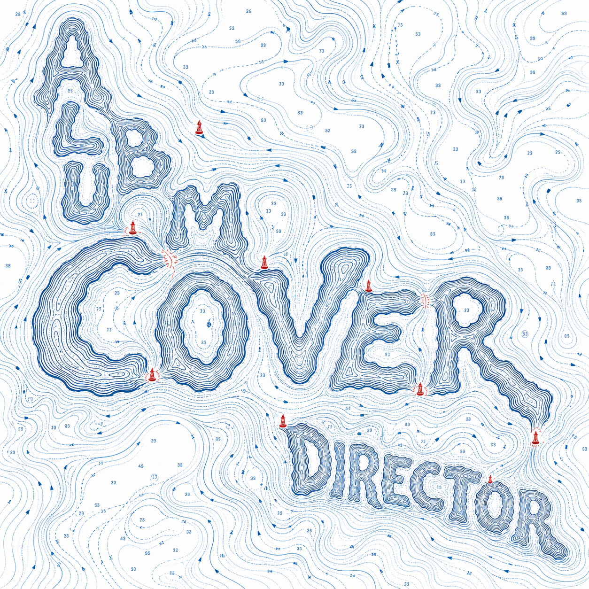
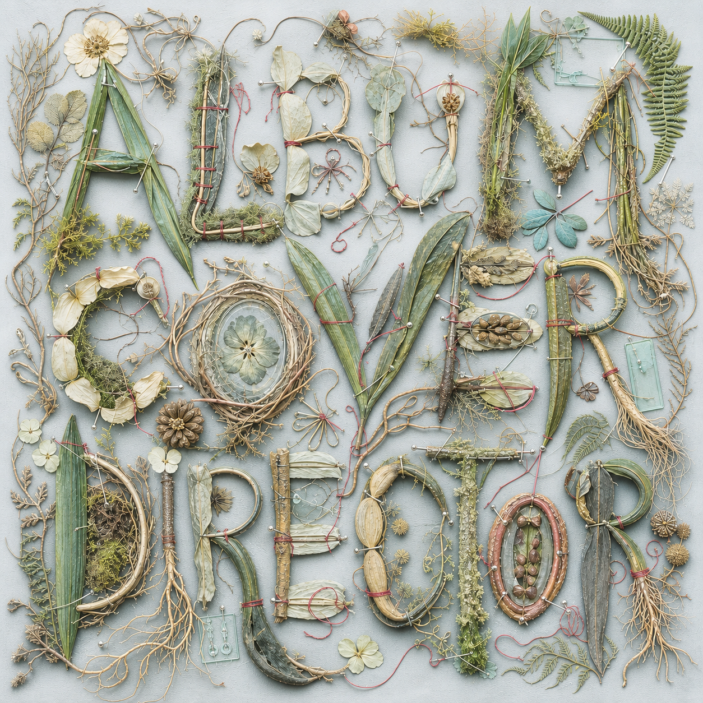
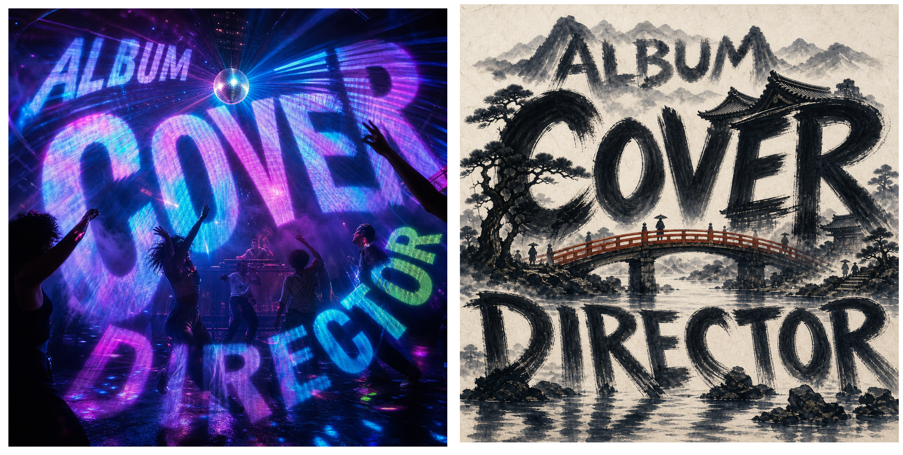
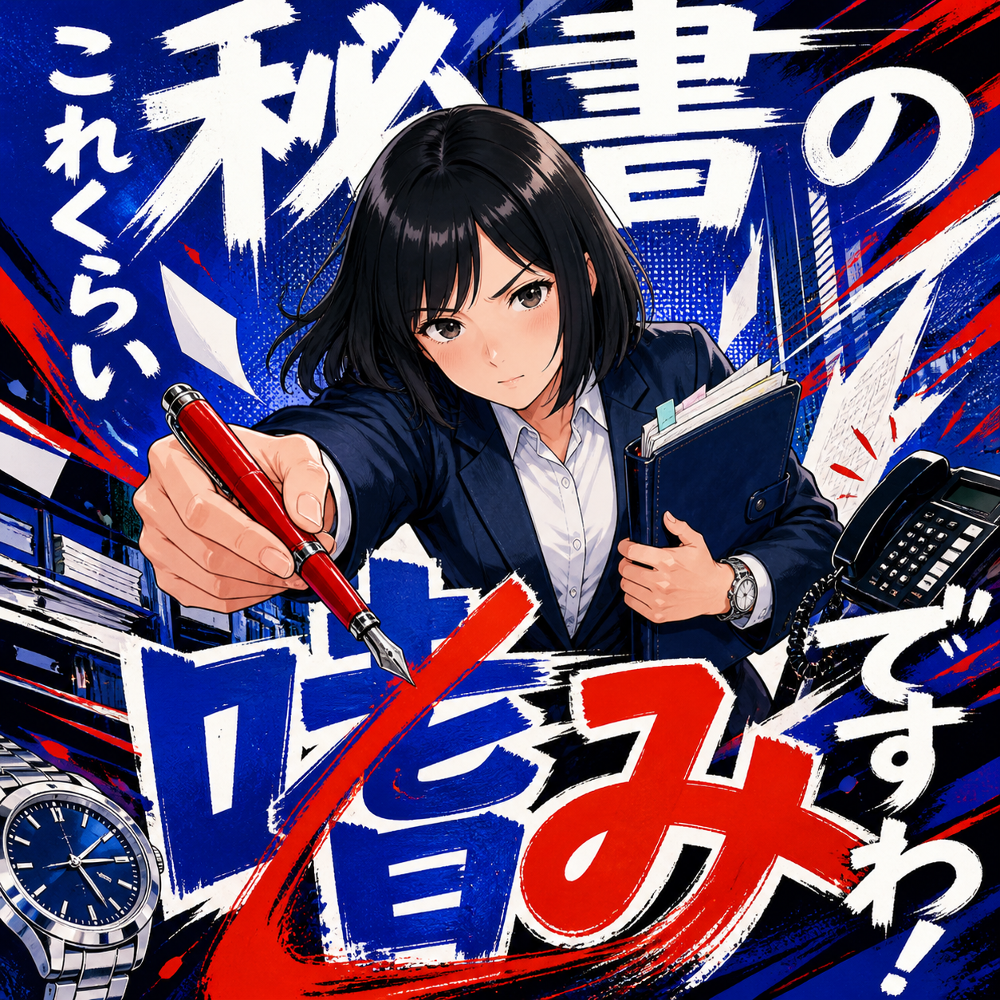
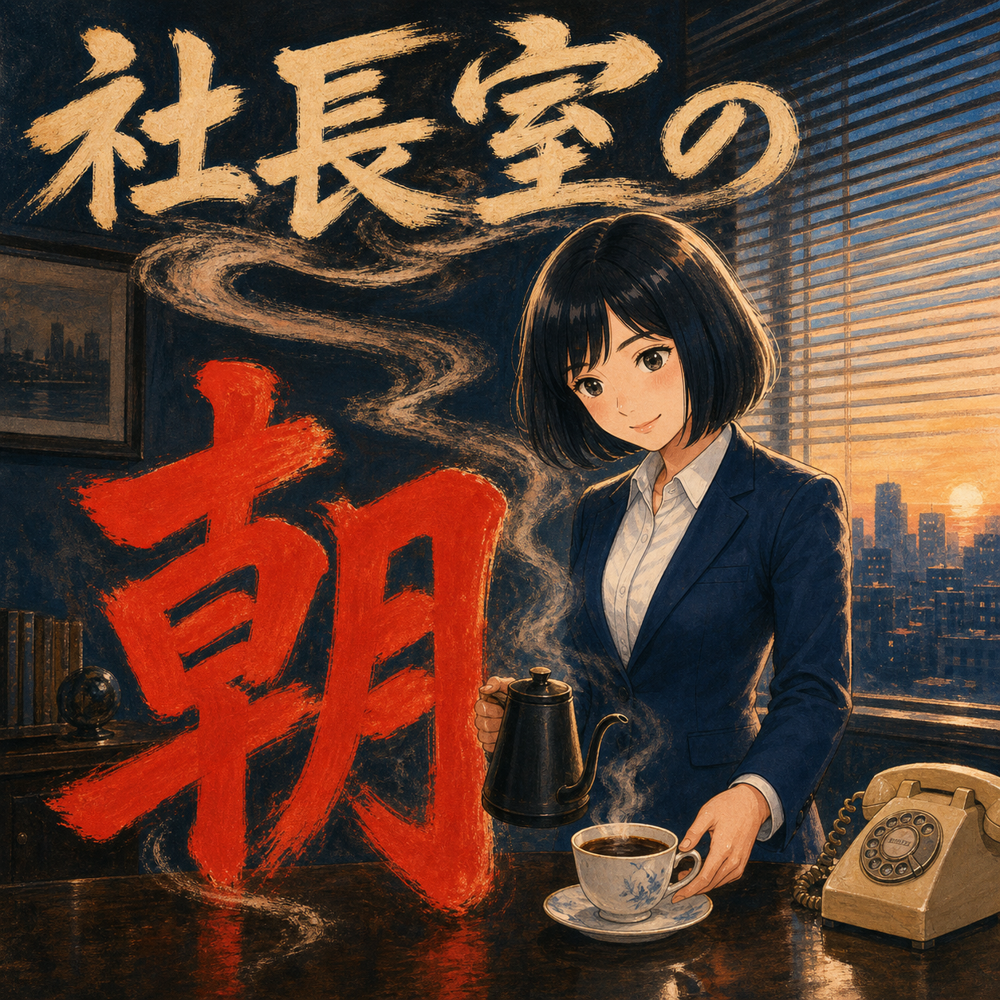
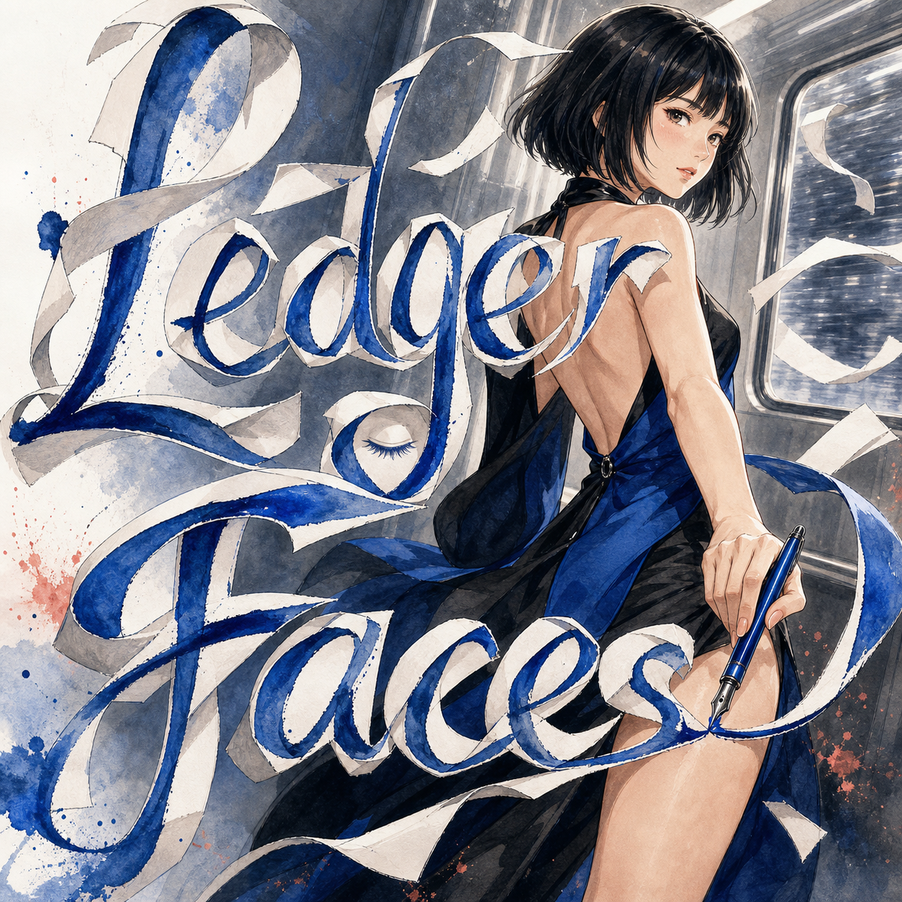

# Album Cover Director

$album-cover-director is a Codex skill and plugin bundle for distinctive album, EP, and single covers. It reads the exact release title, lyrics, and album context; starts with a labeled board of bold, structurally different thumbnail concepts; then finishes the selected idea with image-native title design and 3000 px delivery assets.

The project is for musicians, track makers, producers, independent labels, and designers. It has no artist-specific identity, no required MCP server, and no required API key.

## Explore widely, then finish the choice

The default first pass is **12 different ideas**, each shown as a small image
with an ID, short name, and the meaning it picks up from the music. `deep`
opens that to 16. The goal is to make the first board interesting enough to
choose from without having to ask for “more” first.

The skill builds competing readings from lyrics, song title, and album context,
then varies the mechanism, composition, camera, scale, and medium. Its new
[24 exploration recipes](skills/album-cover-director/references/impact-recipes.md)
include figure/ground reversal, anamorphic alignment, impossible return paths,
two-color collisions, monumental absence, and a single impossible everyday
event. These are ideas to test, not claims of guaranteed model performance.

Choose “C07,” select multiple IDs, or describe a scoped combination such as
“C02's structure with C09's atmosphere.” The selected preview, checksum,
evidence, and composition invariants carry into production. Explore material, spatial, character-led, graphic and optical ideas within
the same workflow. Choose from the music, not a fixed style preference.
The title must visibly participate in each concept; physical/spatial ideas
need real letter-level action, contact, occlusion and depth. A broad first board includes a visibly working optical
idea unless excluded by the user; naming an illusion in a prompt is not enough.
Flat and dimensional work remain equally available; neither replaces the
other, and neither permits an unrelated headline on a finished illustration.

The generated images are inspected together before presentation. The board
utility requires a recorded, checksum-bound visual review; it cannot judge
semantic diversity itself. Initial previews are labeled as concepts with
unverified lettering/detail. The final image still passes the full native-title,
source, and delivery checks. Board labels sit outside the artwork.

## See what it makes

### Titles as physical worlds

|  |  |
| --- | --- |
|  |  |
| **Oceanographic system** — contour lines, routes, and soundings determine the title's anatomy. | **Treasure chart** — folds, compass wells, rope, and red routes make a navigable title artifact. |
|  |  |
| **Board game** — tiles, tracks, bridges, and game pieces turn title letters into a playable system. | **Botanical specimen** — roots, pressed leaves, petals, pins, and thread grow the letters. |


**Mechanized system** — tubes, springs, resonators, and wiring construct a dense acoustic title artifact.

### Titles as spatial events



**Rotating light field** — a small mirror ball, projected letters, smoke, and dancers turn the entire club into one title environment. The letter skeleton stays readable while light, air, and movement distribute it through the image.

**Ink landscape field** — the exact title's brush-letter skeleton spreads through mountains, roofs, bridge rails, riverbanks, mist, and water.

### Character-led title systems

|  |  |
| --- | --- |
|  |  |
| **Title map** — the word is the world. | **Kinetic wordmark** — gesture and title are one action. |
|  |  |
| **Hero wordmark** — person and title share one hierarchy. | **Japanese hierarchy** — a lead-in yields to one giant character. |

Every title above is generated within the image itself. It is never repaired with a font overlay, redraw, or post-typesetting: its material, structure, and image are one design decision.

The gallery demonstrates three equal title-system families. Choose **material-world** when routes, artifacts, games, specimens, or another physical system should form the title's anatomy. Choose **spatial-field** when light, reflection, smoke, motion, weather, or architecture should distribute and transform the title across the full square. Choose **character-led** when a supplied artist system or brief calls for a figure whose pose, action, setting, and title must work as one structure. A spatial field may use a familiar-looking letter skeleton to establish reading, but it must be generated inside the image and physically altered by the scene; it is never a flat overlay.

### What an actual release looks like

**Working title: "Ledger Faces."** Same song, same figure, same exact title. Only the image-organizing structure changes. These are not color variants.


**Character-led** — repeated face profiles fill the counters of the giant title while the living figure steps out through the counter of the letter `a`.



**Material-world** — a continuous blue ledger stroke crosses behind the shoulder, through the hand, and in front of one thigh; the pen draws the final terminal.


**Spatial-field** — station scanner light projects the title across wall, figure, and floor; one blocked beam returns as a reflection in the gate glass.

These existing examples show three families applied to one release. New runs
explore a wider board first, including graphic-field concepts when appropriate,
then finish the selected idea. The gallery is not a benchmark of the new
recipes or GPT Image 2.6.

## What makes it different

- A work-specific research pipeline for covers acclaimed for visual design, with typography-dominant examples screened independently from music reputation.
- Four image-native title-system families: material-world, spatial-field, character-led, and graphic-field, with construction cards and rejection tests.
- Twelve supporting organizing patterns that describe what controls the square, rather than a menu of visual styles.
- Concept-first exploration: 4/12/16 distinct ideas for quick/standard/deep, with evidence-linked interpretations and a compact thumbnail board.
- Separate concept-preview and production-candidate stages: final title lettering must be correct and generated within the artwork, never added afterward.
- Material title-world cards for route fields, constructed artifacts, playable rule systems, and living specimens; a spatial light-and-atmosphere field; plus character-led hero, gesture, and script-hierarchy systems.
- Hierarchy locks for live or spatial images: title area, silhouette, reading route, and value priority are fixed before controlled irregularity is applied to surrounding light, smoke, motion, reflection, or crop.
- Comparative checks at 56 px, 128 px, 256 px, full size, grayscale, and blur.
- One-variable edits, at most two cycles, always returning to the selected original after regression.
- Reproducible 3000 x 3000 PNG/JPG and 256 px thumbnail export.
- Artist-local systems and automatic feedback history that improve future covers without publishing user work.
- A private-to-public contribution path that lets any artist turn a validated local title insight into a reviewable community card without exposing their work.

## Install

### Ask Codex to install the skill

Give Codex this repository path:

~~~text
Install the album-cover-director skill from
https://github.com/usedhonda/album-cover-director/tree/main/skills/album-cover-director
~~~

### Manual skill install

~~~bash
git clone https://github.com/usedhonda/album-cover-director.git
mkdir -p ~/.agents/skills
ln -s "$PWD/album-cover-director/skills/album-cover-director" ~/.agents/skills/album-cover-director
~~~

Restart Codex after installation. The repository root is also a validation-ready Codex Plugin bundle through .codex-plugin/plugin.json; it can be listed by a Codex plugin marketplace without repackaging its skill.

## Use

Explicit:

~~~text
$album-cover-director
Title: Glass Weather
Mode: standard
Lyrics: ...
Artist information: /path/to/artist-information.md
Reference image: /path/to/character.png
Image use: keep the character identity, but redesign the scene and composition
~~~

Natural language:

~~~text
Explore twelve bold cover ideas for my new single using these lyrics and album context.
Show small labeled thumbnails first, then finish my selected idea as a 3000px square.
~~~

The only required input is:

- an exact song, album, or release title.

Lyrics and artist information are optional. Lyrics may be pasted inline or supplied as a readable file path. Artist information may include the artist name, genre, sonic character, points to emphasize, recurring character or identity rules, visual language, palette, typography, avoid list, and references. With no optional input, the skill proceeds from clearly labeled title-based hypotheses. Song and album names supplied as context do not automatically become additional readable cover text.

Reference images are optional. Attach an image or supply a readable file path, then use it as a recurring person or character identity, as an actual image to edit or incorporate, or only as visual direction. When the request is clear, the skill infers the use mode. A recurring character does not freeze the whole cover: pose, action, setting, composition, light, palette, and title architecture remain release-specific. Direct use of the actual image requires the necessary rights.

For a continuing artist, initialize `.album-cover-director/` at that artist's root. Its `artist-system.md` is used only for that artist; an explicit artist-information path is used only for the current run. The skill never remembers an artist system globally or carries it into another artist's workspace.

Run volumes:

| Volume | Initial distinct concepts | Production candidates per selected concept |
| --- | ---: | ---: |
| quick | 4 | 1 |
| standard (default) | 12 | 2 |
| deep | 16 | 2 |

Explicit counts and budgets override these defaults. A request for direct
production, or an existing selected concept, can skip the board. Legacy
three-direction runs retain their 3/6/12 candidate budgets and v1 contracts.

Run intents:

- explore: create the concept board for an early choice;
- production: concept exploration, selection, refinement, and delivery (default);
- improve-skill: a controlled artist-local learning trial.

If you delegate selection to the skill, it chooses from the inspected board
and continues. Otherwise, select by ID before full production. See
[concept-exploration.md](skills/album-cover-director/references/concept-exploration.md).

Typography modes:

- auto;
- image-native;
- custom-wordmark.

Title-system families:

- auto: chooses from the brief;
- material-world: title anatomy is made by a physical system;
- spatial-field: a protected title skeleton is distributed and transformed by light, reflection, atmosphere, motion, or architecture;
- character-led: central figure and title share a single hierarchy;
- graphic-field: native title shape and a flat rule of figure/ground, edge, overlap, or rhythm organize the square together.

## Artist-local learning

Initialize once from the artist root, not from an individual release folder:

~~~bash
python scripts/project-workspace.py init --artist-root .
~~~

```text
<artist-root>/
├── .album-cover-director/               # private and ignored
│   ├── artist-system.md                 # stable artist-wide continuity
│   └── feedback/
│       ├── learned-preferences.md       # automatic repeated-preference summary
│       └── <release-slug>/
│           ├── feedback.json            # selection, corrections, score context
│           └── images/                  # all reviewed candidates and references
└── album-cover/
    └── <release-slug>/                  # brief, prompts, master, delivery
```

Every reviewed image—generated candidate, accepted master, rejected candidate, or supplied reference—is copied automatically into that release's `feedback/<release-slug>/images/`. The user never has to sort reference and trial images into separate folders. Nothing in `.album-cover-director/` is committed or uploaded by this skill.

The artist system is optional: users do not need to write it before their first cover. When missing, the skill creates a starter and drafts it from available song, artist, and reference evidence; the user can correct it in plain language. When it exists, the skill preserves explicit rules and only updates artist-wide continuity from repeated feedback or an explicit request. See [artist-system-onboarding.md](skills/album-cover-director/references/artist-system-onboarding.md).

After a user chooses or rejects candidates, the skill automatically writes
`feedback/<release-slug>/feedback.json`, saves its images, and refreshes
`feedback/learned-preferences.md`. A preference appears in that summary only
after it recurs across three releases; one-off taste never becomes a global
rule. A rule can enter the public skill only after independent, varied trials
and a held-out brief pass. See [project-local-learning.md](skills/album-cover-director/references/project-local-learning.md).

## Share a local discovery

Any user can become a contributor without publishing their artist workspace.
When they say, “share this lesson with the community,” the skill turns the
private success/failure contrast into an abstract `title-behavior-card` draft.
The draft contains a construction rule, boundary, rejection tests, and an
evidence summary—but never the song title, artist system, lyrics, prompt,
feedback wording, images, paths, or local trial IDs.

It remains below that release's private `feedback/` folder until reviewed.
Preparing a draft performs no upload and creates no GitHub Issue, branch, or
pull request. A later explicit request is required to publish it. See
[community-contributions.md](skills/album-cover-director/references/community-contributions.md) and
[CONTRIBUTING.md](CONTRIBUTING.md).

For complex Japanese, mixed-script, long, or punctuation-heavy titles, the
skill classifies the title before generation and changes its native hierarchy,
line break, or protected glyph treatment if it fails. It never repairs text
with later typesetting. See [title-complexity.md](skills/album-cover-director/references/title-complexity.md).

## Output

~~~text
album-cover/<release-slug>/
├── creative-brief.yaml
├── run-contract.json                  # concept-preview
├── concept-board.html
├── production-contract.json           # selected concepts
├── directions.md
├── prompts/
├── run-ledger.jsonl
├── selected-master.png
├── delivery/cover-3000.png
├── delivery/cover-3000.jpg
├── delivery/thumbnail-256.png
├── handoff-manifest.json
└── cover-report.md
~~~

`run-contract.json` records the release, evidence-linked interpretations, runtime, rights basis, preview directions, candidate lineage, and visual review. `concept-board.html` embeds the actual thumbnails and external labels; no web service is required to open it. `production-contract.json` retains selected preview source paths/checksums and starts a separate production candidate set. `handoff-manifest.json` is written only after the selected source, delivery files, and structured human text review have been recorded. If image generation or Pillow is unavailable, the skill returns the finished brief, directions, prompts, and exact export specification, but does not claim that delivery is complete.

## Pattern system

The twelve primary patterns are:

1. Portrait / Identity
2. Documentary Moment
3. Narrative Tableau
4. Symbolic Object / Still Life
5. Typographic Hero / Wordmark
6. Minimal Geometry / Color Field
7. Abstract Material / Process
8. Archive / Collage / Found Material
9. Illustration / Character World
10. Landscape / Architecture / Absence
11. Diagram / Grid / Data / Repetition
12. Package Object / Intervention / Anti-cover

Genre, era, palette, material, and rendering method are separate axes. A direction keeps one genre anchor and betrays one expected code.

## Board and selection utilities

From the repository root, after generating the preview images and completing
`run-contract.json`:

~~~bash
python skills/album-cover-director/scripts/prompt-preflight.py --contract run-contract.json
python skills/album-cover-director/scripts/concept-board.py --contract run-contract.json --output draft-board.html --draft
# Inspect the actual images and record diversity_review before presentation.
python skills/album-cover-director/scripts/concept-board.py --contract run-contract.json --output concept-board.html
python skills/album-cover-director/scripts/concept-selection.py --contract run-contract.json --candidate C07 --reason "The figure/ground reversal expresses the song's tension" --output production-contract.json
~~~

Repeat `--candidate` for multiple independent selections. For one primary and
one donor, use `--candidate C02 --donor C09 --donor-trait "lighting:soft side light"`;
only color, lighting, and texture can be donated, while the primary structure
is preserved. Paths in a contract
resolve relative to that contract. The board has a responsive four-column
layout, supports Japanese labels, embeds resized previews, and never draws
labels onto or modifies the source artwork. `--draft` creates an internal
inspection board; normal presentation requires a matching visual-review
record for every source image. Selection carries the chosen images forward;
these utilities do not call an image API or blend images themselves.

Current GPT Image guidance is [host-aware](skills/album-cover-director/references/runtime-adapters.md):
use 2.6 Flare / Sunburst options only when the host exposes them, record actual
settings, and preserve the selected composition during refinement. No API key
or new server is required. SVG and GIF are not part of this static-cover
implementation.

## Image utility

Pillow is the only optional runtime dependency:

~~~bash
python -m pip install Pillow
python scripts/cover-ops.py inspect selected-master.png
python scripts/cover-ops.py contact-sheet candidates/*.png --output comparison.png
python scripts/cover-ops.py preflight-source selected-master.png --contract production-contract.json
python scripts/cover-ops.py compare candidates/*.png
python scripts/cover-ops.py export selected-master.png --out-dir delivery
python scripts/cover-ops.py preflight-delivery delivery/cover-3000.png --expected-title "Exact Title"
~~~

Run the source preflight before export: it checks the native candidate against the recorded contract without treating a source image as a finished distributor asset. Export writes the 3000 px delivery files; then run delivery preflight on each final asset. Both stages record objective image facts, while a human records exact-title and unapproved-readable-text results in the handoff manifest. `cover-ops.py` intentionally does not add or typeset title text: title typography must be native to the generated cover image. The same utility is bundled in the installed skill at `skills/album-cover-director/scripts/cover-ops.py`; the repository path above is a contributor compatibility wrapper.

## Research and copyright

[research/corpus.yaml](research/corpus.yaml) is a superseded draft and is not a production reference. The current bounded teaching set is distilled in [verified-principles.md](skills/album-cover-director/references/verified-principles.md) from the evidence-complete entries in [typographic-candidates.yaml](research/typographic-candidates.yaml). It exists to improve cover decisions now; it is not a reason to keep collecting precedents during a cover run. The repository contains no third-party album-cover images.

The replacement method requires each admitted work to have cover-specific acclaim evidence, typography dominance at T4 or T5, a direct visual check, and a work-specific transferable principle. Every final record must also name its country, label, and at least two candidate-verified evidence-source IDs. Validation rejects a final corpus if one designer supplies more than three works, one label more than six, one country more than sixteen, one genre more than eighteen, or one source supports more than twelve works. Music rankings, sales, and album fame do not count as cover-design evidence. Future expansion is failure-driven: add research only when repeated real cover runs reveal a missing construction rule, not to enumerate music genres.

[genre-diverse-title-intake.md](research/genre-diverse-title-intake.md) is a separate, capped six-item discovery intake. Its links and observations are not production rules until a private cover trial proves a distinct title-image relationship.

[typography-led-genre-intake.yaml](research/typography-led-genre-intake.yaml) is a cross-genre visual intake selected through image search and direct screening. It stores no third-party images: only release metadata, source pages, observations about how type organizes the square, and transfer questions. Candidates remain discovery-only until production comparisons and held-out briefs reproduce the result.

Reference images supplied during use must be owned, licensed, public-domain, or used only as non-reproduced analytical input. Do not request direct imitation of a living artist.

## Validate

~~~bash
python scripts/validate_repo.py
python -m unittest discover -s tests -v
python /path/to/skill-creator/scripts/quick_validate.py skills/album-cover-director
python /path/to/plugin-creator/scripts/validate_plugin.py .
~~~

CI verifies the skill frontmatter, plugin manifest, explicit superseded/final corpus state, research checkpoint contract and distribution, URL syntax, absence of third-party raster images, and absence of secrets or local absolute paths.

## License

Code, instructions, schemas, and original observations are released under the [MIT License](LICENSE). Third-party album artwork is not included or relicensed.
